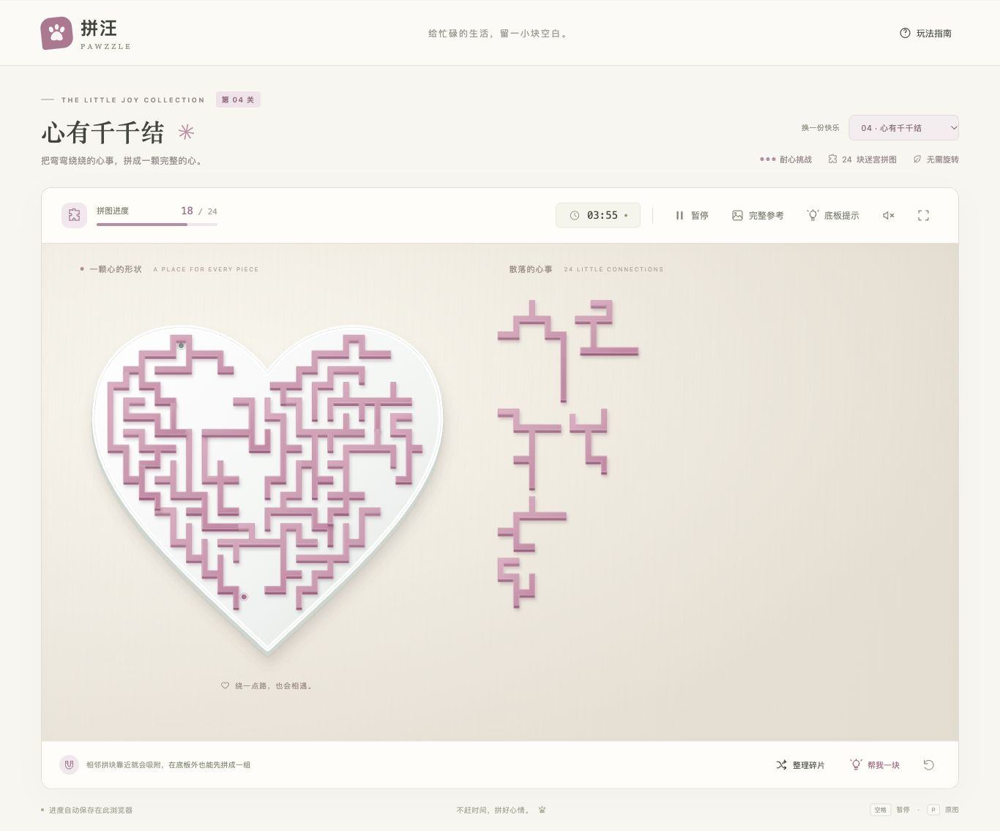
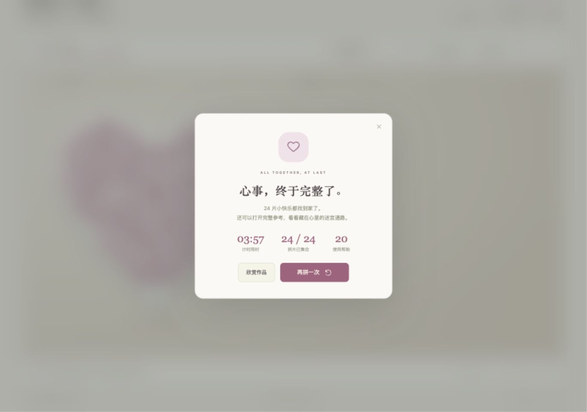
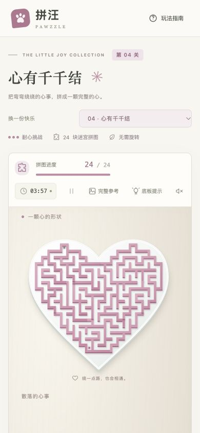

# 04 · 心有千千结

## 关卡简报

2026-10-27。用户要求在新 Git 分支采用 SVG 路线，实现参考照片中的心形迷宫拼图，内部结构可自行设计且必须验证可行。分支：`codex/svg-heart-maze`。

| 项目 | 设计 |
| --- | --- |
| 外观 | 白色心形底托，玫瑰粉塑料墙体，轻微厚度、倒角高光和落影 |
| 几何 | 600 × 600，24 块不旋转的连通正交墙体 |
| 迷宫 | 固定种子 20261027；224 房间、223 条通道；起终点路线经过 81 房间 |
| 操作 | 拖放、相邻拼块场外吸附、整组移动、归位锁定、键盘操作 |
| 辅助 | 底板凹槽开关、完整参考、通路显示、整理碎片、帮我一块 |
| 存档 | `pawzzle-heart-maze-v1-v1`，保存提示开关和进度；前三关键保持原样 |
| 素材 | 原创程序化 SVG；参考照片只用于外观方向，无外链、图片 API 或栅格底图 |

## 几何如何保证成立

1. 先在平滑心形内部选择完整房间，保证全部墙体都在底托内。粗网格间距 24、墙宽 8、通道宽 16。
2. 固定种子的深度优先遍历生成房间生成树。树覆盖所有房间且边数为 `房间数 − 1`，因此连通且任意两点之间只有一条路线。
3. 从完整墙体中挖出生成树通道。剩余 530 个实体网格单元组成墙体。
4. 在墙体图上选择 24 个最远点种子，再同时向外扩展。每个单元只有一个所属拼块，并且通过扩展父节点连接到本块种子。
5. 删除块内共享单元边，追踪块的真实外轮廓。生成器拒绝开口、孤岛、孔洞和夹点；邻接关系只由跨块的实体接缝产生。
6. 游戏、底板凹槽、预览、蓝图和路线图全部消费同一套几何。墙间留白属于通道，不采用普通满版拼图的“填满整个心形”判据。

## 复现

```sh
npm run generate:maze
npm test
npm run build
npm run dev
```

打开 `http://127.0.0.1:5187/?level=04`。无参数默认第四关。`dist/` 为静态构建产物。

| 文件 | 用途 |
| --- | --- |
| `src/maze-geometry.js` | 确定性房间、通道、墙体分片、真实边界、邻接、解路线及桌面布局 |
| `src/maze-art.js` | 共享 SVG 材质、底托、拼块和完整预览 |
| `scripts/generate-maze-level.mjs` | 输出四张独立、自包含的 SVG 检查图及 manifest |
| `tests/maze.test.js` | 迷宫结构、实际 SVG、通路与装配验证 |

导出图：[成品](../../../public/assets/heart-maze-v1/preview.svg)、[通路](../../../public/assets/heart-maze-v1/solution.svg)、[分块蓝图](../../../public/assets/heart-maze-v1/blueprint.svg)、[拼块总览](../../../public/assets/heart-maze-v1/contact.svg)。

## 自动验收

`npm test`：72 / 72 通过；`npm run build`：通过；`git diff --check`：通过。

- 每块实体连通、轮廓无自交、无重复顶点、无孔洞，抓取锚点位于实体内，所有顶点在底托内。
- 实际 SVG 多边形面积与实体单元面积精确相等，所有墙体单元恰有一个所有者。
- 26,244 个空间采样点逐点比对 SVG 并集与独立推导的墙体区域：无重叠、无漏墙、无额外填塞通道。
- 房间生成树连通、边数 223；独立搜索得到同一条 81 房间路线；沿路线每半个单位检查，不穿过任何 SVG 墙体或向下偏移 4 单位的立体侧面。
- 邻接与实体接缝一致且对称；全部 24 块可手动移动归位，最终为一个组；部分完成、完成态都可恢复，重开回到零进度。
- 散片排列测试覆盖 48 种确定性顺序，桌面 690 × 650 和手机 660 × 820 区域内全部放得下、不旋转、不重叠，保留 14 单位间距。
- 预览、路线 SVG 与可玩几何逐字一致，无脚本、外链或栅格图片；前三关及跨关存档隔离回归通过。

## 浏览器实测

在 Codex 浏览器中执行真实指针及键盘操作；未直接改写引擎或存档来伪造通关。

| 检查 | 实测结果 |
| --- | --- |
| 桌面拖拽 | 拖动 m01 到底板，进度 0 → 1，锁定在 `translate(45 60)` |
| 390 × 844 窄屏拖拽 | 上下排列、正常滚动；拖动 m20 归位，进度 1 → 2 |
| 刷新恢复 | m01 仍归位；关闭的底板提示仍保持关闭 |
| 场外组装 | m02 与 m19 在底板外吸附，共享 `data-group=m02` 和相同平移量 |
| 整组与键盘 | 拖动组合，再按 Shift + 左、Shift + 上；两片仍共享完全相同平移量 |
| 组合归位 | 同时归位两片，进度 2 → 4 |
| 完整参考 | 正常打开、关闭；通路开关显示连接绿点与粉点的路线，未穿墙 |
| 暂停 | 页面离开／重新加载触发暂停并可继续 |
| 完整通关 | 4 块经真实拖拽归位，其余 20 块经界面帮助归位；出现 24 / 24 完成弹窗 |
| 完成态 DOM | 24 个已锁定拼块，唯一平移量 `translate(45 60)`，唯一拼块组 |
| 旧关卡 | 切到 03，30 块狗狗与原有控件正常加载 |
| 完成态重新打开 | 新页面成功恢复第四关 24 / 24 进度 |
| 重开 | 通过界面重新开始，进度回到 0 / 24、计时 00:00、24 块重新散开 |
| 控制台 | 交付页面无 error / warn 日志 |

窄屏测试使用桌面浏览器设置的手机尺寸及真实指针拖拽，不等同于已覆盖所有实体手机和触摸浏览器。游戏继续使用项目原有 Pointer Events、触摸取消滚动和边缘自动滚动实现。






